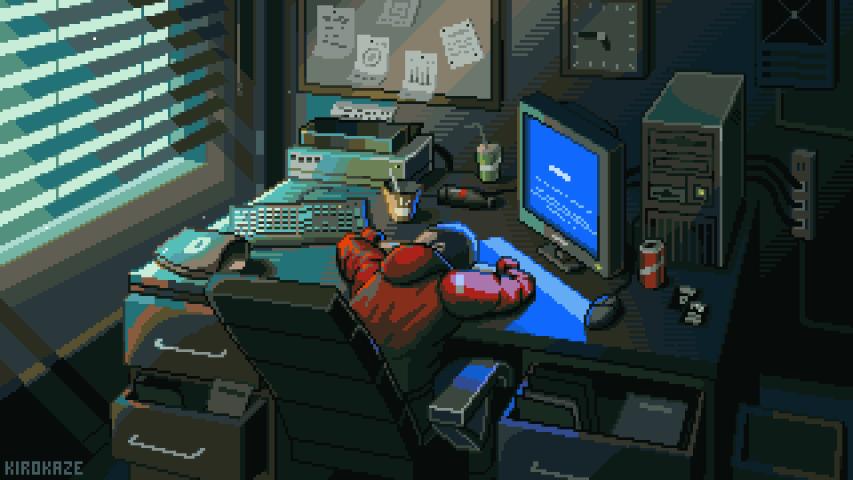

<h1 align="center">
  Hi, I'm Muhammad Fathurrabbany Muhasiby 👋
</h1>

  

  

  

  <a href="#-about-me">About Me</a> •
  <a href="#-tech-stack--tools">Tech Stack</a> •
  <a href="#-featured-projects">Projects</a> •
  <a href="#-github-analytics">Analytics</a> •
  <a href="#-connect-with-me">Connect</a>

---

### 🚀 About Me

- 🎓 Information Systems student at **Airlangga University** (Unair).
- 💻 **Software & Web Developer** passionate about building clean, performant, and reliable applications.
- ⚙️ Currently working with and exploring **TypeScript, Python, Java, and MySQL**.
- 🎨 Passionate about **AI integration and intuitive UI/UX design**.
- 🐧 Linux user exploring automation, backend logic, and smart IoT solutions.
- 💬 Let's talk about software engineering, design systems, or tech in business!

---

### 🛠️ Tech Stack & Tools

  

---

### 🌟 Featured Projects

- 📊 **[nexora](https://github.com/Mufath/nexora)** - Business Intelligence and data analysis platform.
- 🍃 **[UdaraJalan](https://github.com/Mufath/UdaraJalan)** - Real-time air quality tracking and mobile/IoT solution.
- 🤖 **[Hebat-AutoSubmitter](https://github.com/Mufath/Hebat-AutoSubmitter)** - Automation tool built with TypeScript.
- 📡 **[endus-iot-mbg](https://github.com/Mufath/endus-iot-mbg)** - IoT integration and hardware telemetry project.

---

### 📊 GitHub Analytics

<!-- cool-readme:start -->
<!-- Cards by github-cool-readme: https://github.com/pedrocatalao/github-cool-readme -->

<picture>
  <source media="(prefers-color-scheme: dark)" srcset="./cards/languages-dark.svg">
  
</picture>
<picture>
  <source media="(prefers-color-scheme: dark)" srcset="./cards/contributions-dark.svg">
  
</picture>

<picture>
  <source media="(prefers-color-scheme: dark)" srcset="./cards/weekly-dark.svg">
  
</picture>
<picture>
  <source media="(prefers-color-scheme: dark)" srcset="./cards/summary-dark.svg">
  
</picture>

<!-- cool-readme:end -->

  

---

### 🐍 Contribution Activity

  <picture>
    <source media="(prefers-color-scheme: dark)" srcset="./cards/github-contribution-grid-snake-dark.svg">
    
  </picture>

<!--
### 🏆 Certifications & Achievements
(Tambahkan sertifikasi kamu di sini saat sudah ada)

  

-->

---

### 💡 Daily Dev Inspiration

  

---

### 📬 Connect With Me

  
  
  
  

